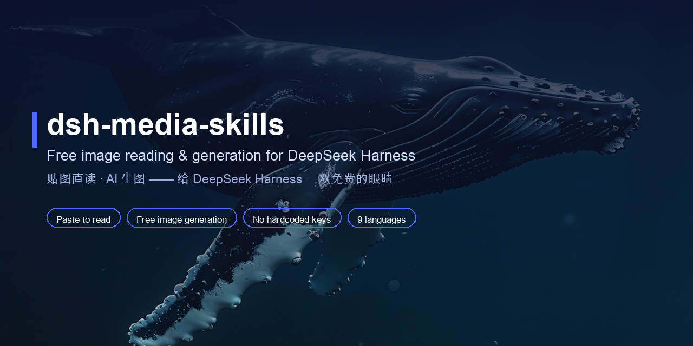
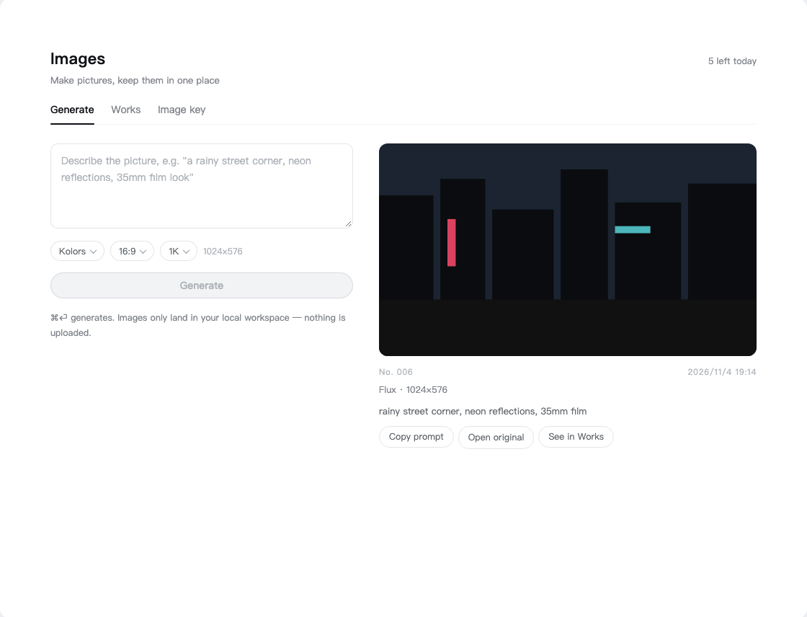
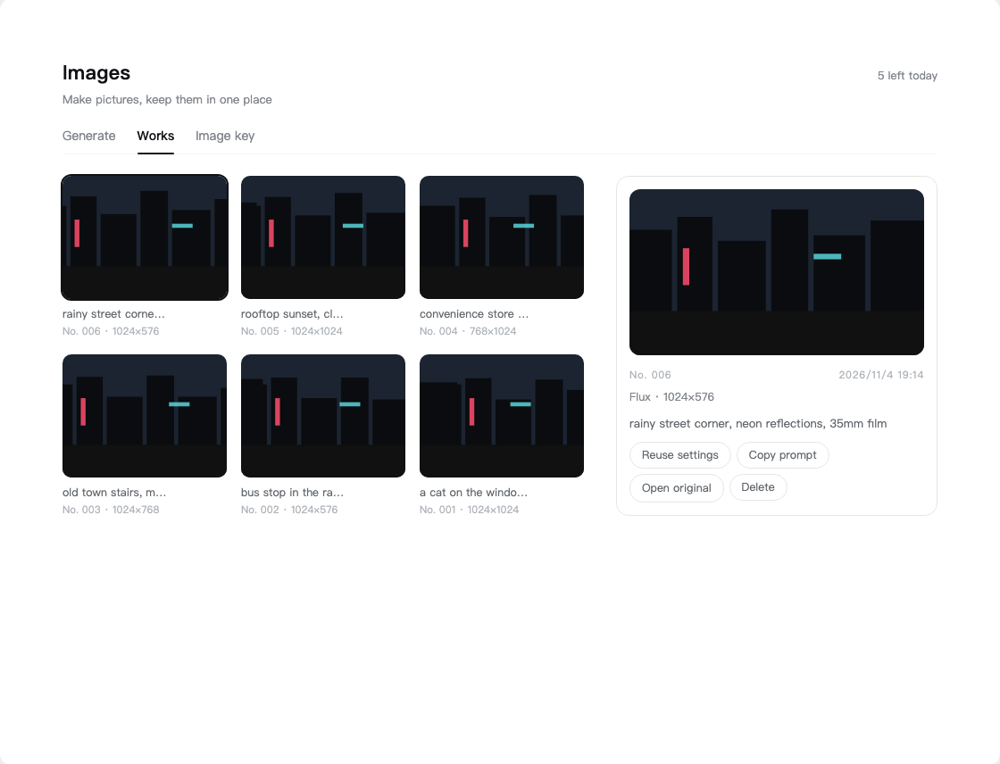
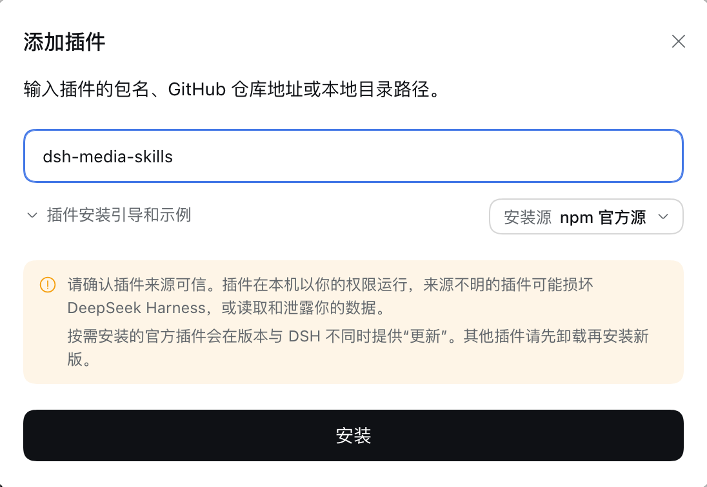
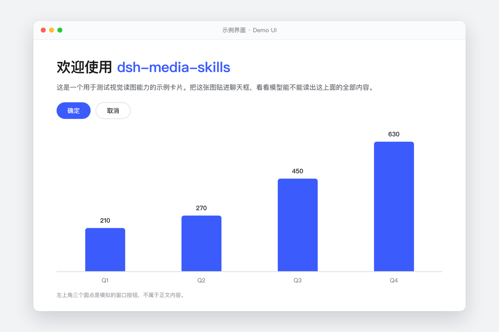

<div align="center">



<br>

# 🎨 dsh-media-skills

### *An Images page in the DSH sidebar — generate images, keep the gallery, and never let a key leave your machine.*

[](LICENSE)
[](https://www.npmjs.com/package/dsh-media-skills)
[](https://python.org)
[](https://github.com/topics/dsh-plugin)
[](README.md#-the-images-page)
[](README.md#-keys--privacy)
[](docs/lang/README_ZH.md)

<br>

On desktop **0.2.1+** a plugin can own a page of its own, so this bundle ships one: **Images**, a sidebar page next to your conversations. The page name and all of its copy follow your DSH language setting: **图像** in Chinese, **Images** in English and everything else. Type a prompt, pick a model, a ratio and a canvas size, and the picture comes back with its own frame number, spec line and actions. Everything you make stays in a contact sheet you can click through.

Under that page sits the same `scripts/generate.py` the agent uses, so **the panel and the `media-tools` skill are one engine, not two**. The bundle also still carries `vision-review` for reading images and screenshots.

No bundled keys, no relay server, no account, no telemetry. Your prompts go from a local Python process straight to the provider you picked.

[Why](#-why) · [The page](#-the-images-page) · [Quick start](#-quick-start) · [Keys & privacy](#-keys--privacy) · [Skills](#-using-the-skills) · [FAQ](#-faq)

[**English**](README.md) · [**简体中文**](docs/lang/README_ZH.md) · [**繁體中文**](docs/lang/README_ZH_TW.md) · [**日本語**](docs/lang/README_JA.md) · [**한국어**](docs/lang/README_KO.md) · [**Español**](docs/lang/README_ES.md) · [**Deutsch**](docs/lang/README_DE.md) · [**Português**](docs/lang/README_PT.md) · [**Русский**](docs/lang/README_RU.md)

</div>

---

## 🤔 Why

Most image plugins either read images or generate them, and many route you through a shared endpoint that sees your pictures and your prompts. This one is built around two rules: **your keys stay on your machine**, and **your prompts go to the provider you chose, from your machine, with nobody in between**.

| | This bundle | Typical image plugin |
|---|---|---|
| Generate images | ✅ SenseNova, SiliconFlow, keyless Pollinations, plus any OpenAI-compatible endpoint | ⚠️ usually one, usually paid |
| A real page for it | ✅ Sidebar page with a gallery, detail card, zoom and delete | ❌ chat commands only |
| Keys | ✅ Written to `~/.dsh/secrets/…` (mode 600), never uploaded, never in the repo | ⚠️ often a shared endpoint or a key in the repo |
| Relay / account | ❌ none — direct HTTPS to the provider | ⚠️ often a hosted middleman |
| Telemetry | ❌ none | sometimes |
| Reading images | ✅ Native attachments plus the `vision-review` skill | ✅ |
| Docs | ✅ 9 languages | ❌ usually English only |

## ✨ What you get

| Piece | What it does | Needs |
|---|---|---|
| 🖼️ **Images page** | Generate, browse a contact sheet, open a detail card, reuse settings, copy the prompt, zoom, delete. Desktop 0.2.1+. | Nothing (Pollinations works without a key) |
| 🎨 `media-tools` skill | "Generate an image of …" from chat; writes to whatever path you ask for. | Any configured provider |
| 👁️ `vision-review` skill | Read images, catch UI visual bugs, detect watermarks, OCR, emit structured evidence. | Native attachments, or a vision key |
| 🔀 Vision failover | GLM-4V-Flash → DeepSeek-V4-Flash-Vision-Exp → Qwen3-VL → SenseNova → Gemini → any OpenAI-compatible endpoint | Optional keys |

## 🖼️ The Images page



**生成** — type a prompt (⌘⏎ also works), then pick:

- **Model** — one row per model, not per provider: `Kolors`, `Qwen-Image`, `Z-Image`, `Z-Image Turbo`, `SenseNova U1 Fast`, `Flux (keyless)`, plus anything your own endpoint exposes. Rows carry a short description and a checkmark; the panel remembers what you picked last time.
- **Ratio** — 智能 / 1:1 / 9:16 / 16:9 / 3:4 / 4:3 / 2:3 / 3:2 / 9:21 / 21:9, drawn as a grid of little canvases.
- **Canvas** — 1K / 2K / 4K long edge. A tier above a model's own ceiling is greyed out with the ceiling written on it, instead of being silently ignored.

The result lands on the right as **one proof card**: the picture, a frame number (`No. 006`), the date, `model · pixels`, the full prompt, and what you can do with it. While it renders you get a skeleton in the shape you asked for.



**作品** — everything generated in this workspace, as a contact sheet with frame numbers and the spec line. Click a tile and the card on the right shows the prompt and four actions: **复用参数** (put the prompt, model, ratio and tier back into the input), **复制提示词**, **打开原图**, **删除** (two-step, and it deletes the file too). Click the picture itself to zoom; `Esc` closes.

**生图 Key** — one row per provider, plus any OpenAI-compatible endpoint you want to add. What you type is written to `~/.dsh/secrets/media-tools.env` with mode 600 by the plugin, and never appears anywhere else. Existing keys show as `••••abcd` with an eye to reveal them.

### No key at all

| Provider | What you get | Catch |
|---|---|---|
| **Pollinations** | Flux, right now, zero setup — it is already in the model list | One image per IP every 45 seconds, ≤768×768, a small logo in the corner |
| **Cloudflare Workers AI** | Roughly **170 flux-1-schnell images a day** on the free plan (10,000 neurons/day) | Needs a Cloudflare account and a Workers AI token; endpoint is per-account (see the FAQ) |
| **ModelScope** | Qwen-Image / Z-Image series | Needs a ModelScope token and a bound Alibaba Cloud account |

The other built-in rows (SenseNova, SiliconFlow) are free-tier-or-cheap third-party APIs: they work the moment you paste a key, and fail with a plain-language message when the account has no credit left.

## ⚡ Quick start

**1. Install — in the app, no terminal.** Four clicks:

> **插件** → **添加插件** → 包名 `dsh-media-skills` → **安装**



1. Sidebar → **插件** (Chinese UI) / **Plugins** (English UI)
2. Top right → **添加插件** / **Add plugin** — the dialog above opens (the screenshot shows the Chinese UI)
3. Type `dsh-media-skills` into the package field, then click **安装** / **Install** — pnpm fetches it, a few seconds
4. It ends with 「请重启 DSH 使更改生效。」 / *Restart DSH for the change to take effect.* — that is the normal ending, not an error

Same thing from a terminal, if you prefer:

```sh
dsh plugin --profile desktop add dsh-media-skills
```

`latest` is the current release; pin a version (`dsh-media-skills@0.7.0`) if you need to. The GitHub form still works: `add github:MJorgin/dsh-media-skills`.

**2. Restart the app** (⌘Q, then open it again). Plugins load at boot — a newly installed page will not appear until you restart. The sidebar then shows a new row: **Images**.

**3. Open Images** in the sidebar and generate something. With no key configured, pick **Flux** — it needs no key at all — and it will just work.

**4. Add a key later** if you want better models: the **生图 Key** / **Image key** tab → paste → **保存** / **Save**. *Configured* / *Not configured* on the row tells you whether the plugin can see a key.

The agent side needs nothing extra: once the bundle is installed, `media-tools` and `vision-review` show up in the skill list.

## 🔑 Keys & privacy

**Short version: a key you paste never leaves your machine except as the `Authorization` header of the request you asked for.**

| Question | Answer |
|---|---|
| Where is the key stored? | `~/.dsh/secrets/media-tools.env`, written by the plugin with mode `600`. The panel never sends it anywhere else, and it is never written into this repo or into a prompt. |
| Does it get uploaded to the author / a relay? | **No.** There is no relay and no account. The generation request is made by a local Python process (`scripts/generate.py`) straight to the provider's HTTPS endpoint. |
| Can a website call these routes? | No. The panel's routes live inside your local DSH server and are same-origin checked: a request must carry a `Host` header, and its `Origin`/`Referer` host must match it. |
| Can the file routes read anything on disk? | No. They resolve the path first and refuse anything that is not inside `uploads/media` — `../../package.json` gets a 403. |
| Is there telemetry? | No. No analytics, no ping, no update check. |
| What actually leaves the machine? | The prompt, the model name and the size — to the provider you selected. Nothing else. Generated files stay in your workspace. |
| Does 删除 really delete? | Yes — the file is removed from disk, not just hidden from the list. |

Keys are read in this order: environment variables → `~/.dsh/secrets/media-tools.env` → `~/.codex/secrets/media-tools.env` (legacy fallback).

> **One honest caveat:** a provider's free tier comes with that provider's data-use terms. Google's free Gemini tier may use requests to improve its products; Pollinations is a free public service; Cloudflare's free plan has its own terms. For sensitive images (IDs, internal docs, customer data), read the terms of whichever provider you picked, or keep it local.

## 🚀 Using the skills

The page is the comfortable path; the skills are for the agent and for scripts.

| Way | How | When |
|---|---|---|
| **A. The page** | Sidebar → Images | Everyday generation, browsing what you made |
| **B. Chat** | "Generate an image of a rainy street at night" → `media-tools` | Quick one-offs inside a conversation |
| **C. Direct** | `python3 skills/media-tools/scripts/generate.py "prompt" out.png 1024x576` | Automation, loops, your own pipeline |

The script takes a size as `16:9`, `1024x576` or nothing at all, and honours `MEDIA_PROVIDER` / `MEDIA_MODEL` / `MEDIA_API_URL` / `MEDIA_API_KEY` when you want to point it somewhere specific. See [skills/media-tools/SKILL.md](skills/media-tools/SKILL.md).

## ❓ FAQ

**Do I need a key to try it?**
No. Install, restart, open Images, pick **Flux** (Pollinations, no key needed). It is rate-limited and has a logo, but it is zero setup.

**I pasted a free Cloudflare / SiliconFlow key and generation fails.**
The panel maps provider errors to plain language: `402` means the account has no credit, `401` means the key is wrong, `404` means the address or model name is off, `429` means too many requests. A SiliconFlow account with a zero balance returns 402 even on models that are advertised as free.

**How do I use Cloudflare Workers AI?**
Create an API token with the **Workers AI** template, find your Account ID, then add a custom provider with the address `https://api.cloudflare.com/client/v4/accounts/<ACCOUNT_ID>/ai/run/@cf/black-forest-labs/flux-1-schnell`, model left empty, and the token as the key. It ignores the ratio picker and returns roughly 1024×1024.

**Does the panel work on older DSH builds?**
The page needs desktop **0.2.1+** (that is when plugins could register sidebar pages). On older builds the two skills still install and work; you just don't get the page.

**Why does the model list only show one row?**
Because rows are models, not providers: if only one provider has a key, only its models are usable (the rest are greyed out). Pollinations is always usable.

## 🎁 Examples

Six AI-generated images with their prompts, plus a vision test card for checking reading accuracy:

 

The vision test card — title, two buttons, four bar values and a footer note:



→ [examples/README.md](examples/README.md)

## 🗺️ Layout

```
dsh-media-skills/
├── package.json            # dsh.bundle + dsh.client manifest
├── cordis.patch.yml        # plugin layer
├── index.js                # skills + the /media/* routes the page talks to
├── client.js               # the Images page (sidebar entry + panel UI, no build step)
├── skills/
│   ├── media-tools/        # image generation (generate.py)
│   └── vision-review/      # image reading
├── scripts/
│   ├── check-panel.mjs     # provider/model resolution tests
│   ├── check-routes.mjs    # route, same-origin and path-traversal tests
│   └── generate.py         # the one engine both the page and the skill use
├── examples/               # sample images + vision test card
└── docs/
    ├── screenshots/        # panel and demo images
    ├── SETUP_VISION_EN.md  # detailed setup guide (English)
    ├── SETUP_VISION.md     # 详细配置指南（中文）
    └── lang/               # READMEs in 9 languages
```

## 🧩 Using ModLens alongside?

This bundle and [ModLens](https://github.com/liustack/modlens) can be installed together, but desktop 0.2 does **not** provide the old api-proxy auto-transcription fallback. Choose one paste behavior deliberately: keep ModLens paste-to-path interception for file-path tool workflows, or set `pasteToPath: false` so DSH uses native image attachments with an image-capable route. See [docs/COMPARE_MODLENS.md](docs/COMPARE_MODLENS.md) (中文).

## 🤝 Join the DSH plugin ecosystem

DeepSeek Harness developer preview is still evolving; core plugins and base APIs will keep iterating.

- [dsh-plugin topic](https://github.com/topics/dsh-plugin)
- [Quickstart](https://deepseek-harness.github.io/deepseek-harness/guide/quickstart)
- [DeepSeek Harness repo](https://github.com/deepseek-ai/deepseek-harness)
- [dsh-agent-conductor](https://github.com/MJorgin/dsh-agent-conductor) — 同作者的指挥家：在 DSH 里派活给 11 种外部 agent CLI（Codex / Claude Code / TraeCode…）

> This repo is tagged [`dsh-plugin`](https://github.com/topics/dsh-plugin) and listed in the [awesome-dsh-plugin](https://github.com/awesome-dsh-plugin/awesome-dsh-plugin) curated list. PRs, issues and translations are welcome.

## 📄 License

[MIT](LICENSE)
