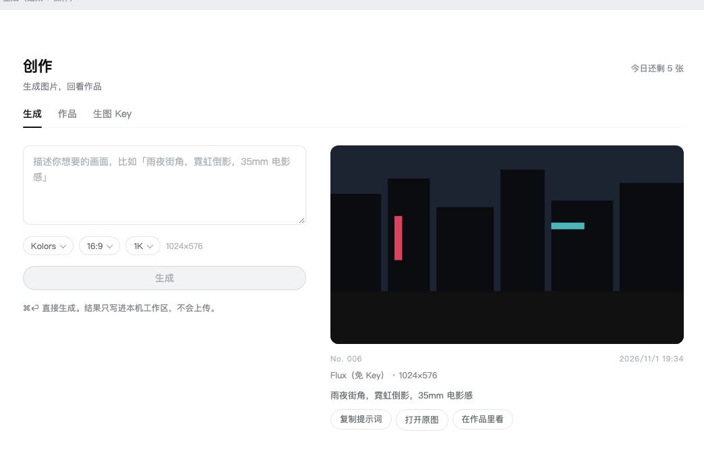
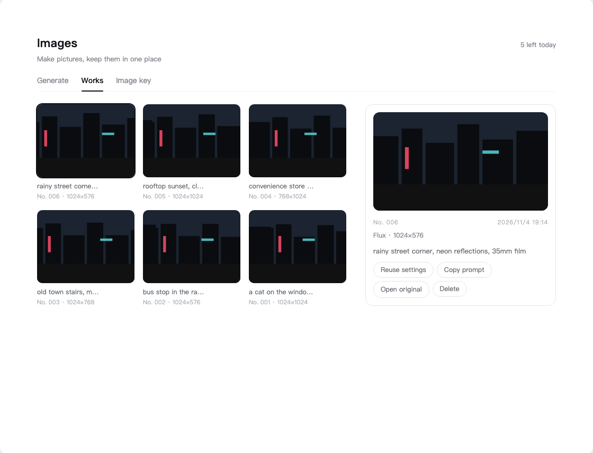

> **Version note:** This translation may describe an older release. For the current Images page and setup, see the [English README](../../README.md) or [简体中文](README_ZH.md).

<div align="center">


<br>

# 🎨 dsh-media-skills

### *Pega una imagen directamente en el chat: modelo de visión, lectura y generación de imágenes gratis.*

[](../../LICENSE)
[](https://python.org)
[](https://github.com/topics/dsh-plugin)

<br>

Dale a [DeepSeek Harness](https://github.com/deepseek-ai/deepseek-harness) «ojos» y un «pincel»:
dos skills gratuitas, un modelo de visión gratuito y lectura de imágenes pegadas, sin claves hardcodeadas.

[Capacidades](#-capacidades) · [Inicio rápido](#-inicio-rápido) · [Uso](#-uso) · [Guía de visión](../SETUP_VISION.md)

[**English**](../../README.md) · [**简体中文**](README_ZH.md) · [**繁體中文**](README_ZH_TW.md) · [**日本語**](README_JA.md) · [**한국어**](README_KO.md) · [**Español**](README_ES.md) · [**Deutsch**](README_DE.md) · [**Português**](README_PT.md) · [**Русский**](README_RU.md)

</div>

---

## ✨ Capacidades

| Capacidad | Qué hace | Modelo | Coste |
|---|---|---|---|
| 🖼️ Lectura de imágenes pegadas | En una sesión **de solo texto** (p. ej. deepseek-v4-pro), la barra de entrada gana un botón «Añadir imagen» (icono de imagen); las imágenes pegadas son descritas por el modelo de visión y entregadas al modelo actual como texto (**desde v0.1.1, DeepSeek-V4-Flash-Vision-Exp por defecto**) | v0.1.1: DeepSeek-Vision-Exp · rc.7/8: Zhipu GLM-4V-Flash | GLM gratis; DeepSeek facturado a tu saldo (por defecto en v0.1.1) |
| 🧠 Ruta de modelo de visión | En ≤ v0.1.1, tras instalar añade **automáticamente** «智譜 GLM-4V-Flash（視覚）」 al selector de modelos (**en v0.1.6**: añádelo una vez en **Ajustes → Modelos**); úsalo en una conversación nueva para hablar sobre imágenes | Zhipu GLM-4V-Flash | Gratis |
| 👁️ `vision-review` | Analizar / reconocer / describir imágenes y capturas; detectar bugs visuales de UI (solapamientos, desbordes, desalineaciones); detectar marcas de agua/logos; convertir imágenes a texto. Cadena de motores: GLM-4V-Flash → DeepSeek-V4-Flash-Vision-Exp (misma clave que el agente, de pago opcional) → SenseNova / SiliconFlow / Gemini | GLM-4V-Flash＋DeepSeek-Vision-Exp＋SenseNova＋Gemini | Gratis (DeepSeek de pago opcional) |
| 🎨 `media-tools` | Generar imágenes, ilustraciones, avatares, fondos y banners | SenseNova U1 Fast → SiliconFlow Kolors | Gratis, sin marca de agua |

> ⚠️ Nota honesta: la lectura de imágenes pegadas vive en el **núcleo** de DeepSeek Harness — nativa en **v0.1.6 / v0.1.1**; en rc.7 / rc.8 mediante los parches de núcleo incluidos (admisión de imágenes en `api-proxy`). Este bundle aporta las **skills** (en ≤ v0.1.1 también la ruta de modelo); el modelo de visión funciona en cualquier build de DSH.

## ⚡ Inicio rápido

1. Instala el bundle:

   ```sh
   dsh plugin --profile <name> add dsh-media-skills
   ```

2. **Claves**:
   - **v0.1.6**: no necesitas claves para instalar — los dos skills se registran en tiempo de ejecución. Las claves de los skills (`GLM_API_KEY`, `SILICONFLOW_API_KEY`, opcional `GEMINI_API_KEY`) van en `~/.dsh/secrets/media-tools.env` (ver [Claves](#-claves)); las rutas de modelos nativas las configuras en **Ajustes → Modelos**.
   - **en v0.1.1-rc.1+ no hace falta ninguna clave extra** — la lectura de imágenes pegadas y la ruta de visión usan el `DEEPSEEK_API_KEY` existente del agente. Para los motores gratuitos (o rc.7/rc.8): primero consigue la clave gratis — regístrate en [open.bigmodel.cn](https://open.bigmodel.cn) → **API Keys** (glm-4v-flash es gratis). Si también quieres generar, crea otra en [siliconflow.cn](https://siliconflow.cn) (Kolors es gratis). Luego configúrala — GUI web (**Ajustes → Modelos**) o archivo de credenciales:

   ```sh
   # ~/.dsh/.credentials.yaml (chmod 600)
   GLM_API_KEY: <tu clave>
   ```

3. **Reinicia por completo** `dsh web` y haz un refresco forzado (`Cmd+Shift+R`).

4. Verifica: en la lista de skills aparecen **`vision-review`** y **`media-tools`** (en v0.1.6 configura la ruta de visión en **Ajustes → Modelos**; en ≤ v0.1.1 el selector de modelos muestra **智譜 GLM-4V-Flash（視覚）**). Si tu build soporta la lectura de imágenes pegadas, la barra de entrada muestra un botón 🖼️ **Añadir imagen** — pega una imagen en cualquier sesión y llegará como descripción de texto.

Guía completa, funcionamiento y resolución de problemas: **[../SETUP_VISION.md](../SETUP_VISION.md)**

## 🔑 Claves

Las claves **nunca se guardan en este repo**. Los scripts leen, en orden: variables de entorno → `~/.dsh/secrets/media-tools.env` → `~/.codex/secrets/media-tools.env` (fallback legado). La ruta del modelo de visión lee `GLM_API_KEY` del almacén de credenciales de DSH (≤ v0.1.1; en v0.1.6 configuras las rutas en **Ajustes → Modelos**).

Dónde conseguirlas: en v0.1.1+ usa el DEEPSEEK_API_KEY existente del agente (sin claves extra). Motores gratuitos: Zhipu — [open.bigmodel.cn](https://open.bigmodel.cn) → API Keys (glm-4v-flash). SiliconFlow — [siliconflow.cn](https://siliconflow.cn) → API Keys (Kolors).

```sh
# ~/.dsh/secrets/media-tools.env (chmod 600, una KEY=value por línea)
GLM_API_KEY=...
SILICONFLOW_API_KEY=...
```

## 🖼️ El panel Images (desktop 0.2.1+)



Desde el escritorio 0.2.1 un plugin puede registrar su propia página; este paquete trae **Images** en la barra lateral. El nombre y los textos siguen el idioma de la interfaz de DSH (en chino «图像», en lo demás «Images»):

- **生成**: escribe un prompt (⌘⏎ también genera), elige modelo, proporción y tamaño de 1K a 4K. Los modelos van una fila por modelo, no por proveedor, y hay 10 proporciones (inteligente / 1:1 / 9:16 / 16:9 / 3:4 / 4:3 / 2:3 / 3:2 / 9:21 / 21:9). Los tamaños que superan el límite de un modelo se muestran en gris en lugar de ignorarse. El resultado llega como una tarjeta con número, modelo, tamaño, prompt y acciones.
- **作品**: todas las imágenes de este espacio de trabajo en una hoja de contactos; haz clic en una para abrir la ficha y reutilizar los ajustes, copiar el prompt, abrir el original o borrarla (también el archivo). Haz clic en la imagen para ampliarla; `Esc` cierra.
- **生图 Key**: pega una clave por proveedor. Se guarda en `~/.dsh/secrets/media-tools.env` (permisos 600), **nunca se sube** y solo se usa para generar. Las claves guardadas se muestran como `••••abcd`, con un ojo para verlas un momento.
- **¿Sin ninguna clave?** Elige **Flux (免 Key)**: Pollinations no pide registro ni clave (una imagen por IP cada 45 segundos, hasta 768×768, con un pequeño logo).

En la app de escritorio: barra lateral **Plugins** → **Add plugin** (arriba a la derecha) → escribe `dsh-media-skills` → **Install**. Después reinicia la app una vez (los plugins se cargan al arrancar). También desde la terminal:

```sh
dsh plugin --profile desktop add dsh-media-skills
```



## 🚀 Uso

Tres formas de leer imágenes:

| Forma | Cómo | Cuándo |
|---|---|---|
| **A. Pegar directamente (recomendado)** | En cualquier sesión, pulsa el botón 🖼️ / arrastra / pega una imagen y envíala | Preguntas cotidianas sobre imágenes: sin guardar archivos ni cambiar de modelo |
| **B. Sesión con modelo de visión** | Conversación nueva, elige 智譜 GLM-4V-Flash（視覚）, pega imágenes y conversa | Conversaciones de varias rondas sobre imágenes, `read_image` nativo |
| **C. Archivos + skill** | Pon la imagen en el workspace y di «lee esta imagen con vision-review» | Revisión por lotes, flujos con scripts |

El idioma de la descripción sigue al de tu mensaje (mensaje en chino → descripción en chino; en inglés → en inglés; sin texto → chino).

También puedes decir:

- «Mira esta imagen / revisa esta captura en busca de bugs visuales» → `vision-review`
- «Genera una imagen de …» → `media-tools`

## 🗺️ Estructura

```
dsh-media-skills/
├── package.json           # manifiesto dsh.bundle
├── cordis.patch.yml       # capa de plugin
├── index.js               # registra los dos skills mediante el ciclo de vida del provider de DSH v0.1.6
├── skills/
│   ├── vision-review/     # lectura de imágenes
│   └── media-tools/       # generación de imágenes
├── docs/
│   ├── SETUP_VISION.md    # guía de visión (chino)
│   ├── SETUP_VISION_EN.md # detailed setup guide (English)
│   └── lang/              # READMEs en otros idiomas
├── scripts/make-banner.py # regenera docs/social-preview.png
└── docs/social-preview.png
```

## 🤝 Únete al ecosistema de plugins de DSH

La vista previa para desarrolladores de DeepSeek Harness sigue en fase de pruebas para desarrolladores de Harness; los plugins principales y las APIs base seguirán iterando. Esperamos explorar juntos los límites superiores de la inteligencia, con desarrolladores de todo el mundo, sobre infraestructura de código abierto, abierta, reutilizable y componible.

- [Topic dsh-plugin](https://github.com/topics/dsh-plugin)
- [Inicio rápido](https://deepseek-harness.github.io/deepseek-harness/guide/quickstart)
- [Repo de DeepSeek Harness](https://github.com/deepseek-ai/deepseek-harness)

> Etiqueta este repo con [`dsh-plugin`](https://github.com/topics/dsh-plugin) para que otros lo descubran.

## 📄 Licencia

[MIT](../../LICENSE)
