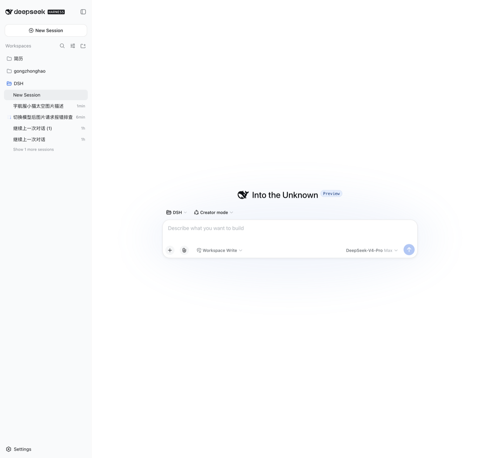
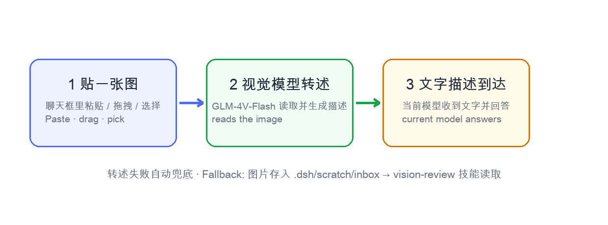

<div align="center">


<br>

# 🎨 dsh-media-skills

### *给 DeepSeek Harness 提供可复用的读图与生图技能 —— 已在桌面端 0.2.0-rc.2 验证。*

> 本翻译已与英文版同步；若后续版本出现差异，以英文版 [README.md](../../README.md) 为准。

[](../../LICENSE)
[](https://python.org)
[](https://github.com/topics/dsh-plugin)
[](../SETUP_VISION.md)
[](../FREE_VISION_PROVIDERS.md)
[](README_ZH.md#-密钥与隐私)
[](README_ZH.md)

<br>

DeepSeek Harness 很会推理，但图片能否发送取决于当前模型声明的输入模态。这个 bundle 提供**两个运行时 Skill** 和**自带 Key 的视觉引擎故障转移链**，已在桌面端 **0.2.0-rc.2** 完成运行时验证，并对最新 tag **dsh-v0.2.1-alpha.2** 做了同契约源码比对：

- 🖼️ **原生图片附件** —— 桌面端 0.2 / v0.1.6+ 可在**当前模型支持图片**时粘贴、拖拽或选择图片（默认 `deepseek-flash` 支持）；纯文本模型会拒绝图片，旧的自动转述兜底不再生效。
- 👁️ **`vision-review`** —— 分析图片与截图、检查界面视觉 Bug、检测水印 Logo、把图片转成文字。
- 🎨 **`media-tools`** —— 免费生成插画、头像、背景、Banner，无水印。
- 🔀 **引擎故障转移** —— GLM-4V-Flash（免费）→ **DeepSeek-V4-Flash-Vision-Exp**（与主 agent 同 key，付费可选）→ SiliconFlow Qwen3-VL → SenseNova → Google Gemini（免费 key 从 [AI Studio](https://aistudio.google.com) 领取）→ 任意 OpenAI 兼容端点，支持 modlens 同款结构化证据输出。

桌面端 0.2 上无需核心补丁、不写隐藏设置、不内置任何 Key；生成图片只保存到技能明确指定的路径。

[为什么](#-为什么) · [快速开始](#-快速开始) · [效果预览](#-效果预览) · [使用方式](#-使用方式) · [密钥与隐私](#-密钥与隐私) · [常见问题](#-常见问题) · [示例](#-示例)

[**English**](../../README.md) · [**简体中文**](README_ZH.md) · [**繁體中文**](README_ZH_TW.md) · [**日本語**](README_JA.md) · [**한국어**](README_KO.md) · [**Español**](README_ES.md) · [**Deutsch**](README_DE.md) · [**Português**](README_PT.md) · [**Русский**](README_RU.md)

</div>

---

## 🤔 为什么

市面上的 DSH 视觉插件大多只能**读图**，而且很多让你走一个共享的第三方端点。`dsh-media-skills` 的思路不一样：

| 对比项 | 本 bundle | 常见「只读图」插件 |
|---|---|---|
| 读图能力 | ✅ 桌面端 0.2 走当前选中的图片模型；`vision-review` 额外提供 GLM-4V-Flash 与多引擎脚本化故障转移 | ✅ |
| **免费生图** | ✅ SenseNova U1 Fast → SiliconFlow Kolors | ❌ 通常没有 |
| 模型路由管理 | ✅ 桌面端 0.2 / v0.1.6+ 不写设置，统一在 **设置 → 模型** 选择；旧版自动写入仅属历史行为 | 视插件而定 |
| Key 是否入库 | ❌ 绝不，密钥只留在本地 | ⚠️ 经常要求配置 |
| 多语言文档 | ✅ 9 种语言 | ❌ 通常只有英文 |
| 隐私 | ✅ 图片只发给你自己选的提供方 | 共享免费端点可能看到你的图片 |

**为什么用「自带免费 Key」而不是内置匿名端点？** 为了隐私和稳定性。你的图片只发给你选的提供方，走你自己的账号和速率限制，中间没有任何共享第三方服务。

**新版本适配**：

| DSH 版本 | 状态 |
|---|---|
| 桌面端 **0.2.0-rc.2** | **运行时已验证**：标准运行时插件，两个技能通过 `ctx.skills.registerProvider()` 注册；当前模型声明 `inputModalities: ["text", "image"]` 时才接受原生图片附件，默认 `deepseek-flash` 支持。无需核心补丁、不写设置。 |
| Tag **dsh-v0.2.1-alpha.2** | **源码已比对**：`@deepseek-ai/dsh-skill@0.2.1-alpha.2` 保留相同的 provider factory、数组/`{candidates, complete}` 返回形状、candidate 字段和图片准入逻辑；本机没有 alpha 桌面安装包，因此未做完整启动验证。 |
| **v0.1.6** | 使用同一套受支持的 provider 生命周期；GLM / SiliconFlow / SenseNova / Gemini 等额外路由在 **设置 → 模型** 自行配置。 |
| v0.1.1 及更早预览版 | 仅保留历史说明；不要把旧核心补丁用于已签名的桌面端 0.2。 |

完整检查清单和 `MODEL_DOES_NOT_SUPPORT_IMAGES` 行为见 [桌面端 0.2 兼容说明](../DESKTOP_0.2.md)。

## ✨ 能力一览

| 能力 | 桌面端 0.2 的行为 | 模型 / 引擎 | 费用 |
|---|---|---|---|
| 🖼️ 原生图片附件 | 在选中图片模型时，可粘贴、拖拽或点附件按钮发送。DSH 按当前模型的 `inputModalities` 做准入；纯文本路由返回 `MODEL_DOES_NOT_SUPPORT_IMAGES`，不会执行旧版自动转述管道。 | 默认 `deepseek-flash`，或你配置的视觉路由 | 以所选服务商为准 |
| 👁️ `vision-review` | 分析 / 识别 / 描述本地图片与截图；检查重叠、溢出、错位、水印 Logo、OCR，或输出结构化 JSON 证据。故障转移链：GLM-4V-Flash → DeepSeek 视觉模型 → SiliconFlow Qwen3-VL → SenseNova → Google Gemini → 自定义 OpenAI 兼容端点。 | GLM-4V-Flash + 可选 DeepSeek/Qwen/SenseNova/Gemini | GLM/SiliconFlow 免费额度；其他引擎可选 |
| 🎨 `media-tools` | 按提示词生成图片、插画、头像、背景、Banner，并写到明确指定的输出路径。 | SenseNova U1 Fast → SiliconFlow Kolors | 服务商免费额度/条款；不内置 Key |

## ⚡ 快速开始

在 DSH **插件管理器**里添加 `dsh-media-skills`，或命令行安装：

```sh
dsh plugin --profile <name> add dsh-media-skills
```

1. **Key**：
   - **桌面端 0.2 / v0.1.6+**：安装无需 Key——两个技能随插件运行时注册；默认 `deepseek-flash` 已支持原生图片对话。使用技能脚本时把 Key（`GLM_API_KEY`、`SILICONFLOW_API_KEY`、可选 `GEMINI_API_KEY`）写进 `~/.dsh/secrets/media-tools.env`；额外模型路由在 **设置 → 模型** 自行配置。
   - **v0.1.1-rc.1+**：零额外配置——贴图转述与视觉路由直接用主 agent 的 `DEEPSEEK_API_KEY`（DeepSeek-V4-Flash-Vision-Exp）。
   - **rc.7 / rc.8**（或想加免费引擎）：智谱：[open.bigmodel.cn](https://open.bigmodel.cn) → 「API Keys」（glm-4v-flash 免费）；SiliconFlow：[siliconflow.cn](https://siliconflow.cn) → 「API 密钥」（Kolors 免费）；*（可选）* Google Gemini：[aistudio.google.com](https://aistudio.google.com) → 「Get API key」，配好后自动加入读图回退链
2. **填入**：Web 界面（**设置 → 模型**），或写在凭据文件里：

   ```sh
   # ~/.dsh/.credentials.yaml（chmod 600）
   GLM_API_KEY: <你的智谱 Key>
   ```

3. **彻底重启 DSH**（桌面端则重启应用；浏览器页面再按 `Cmd+Shift+R` 强刷）。

验证：技能列表出现 **`vision-review`** 与 **`media-tools`**。桌面端 0.2 发送原生图片附件前，请确认当前路由是支持图片的 **`deepseek-flash`** 等模型；纯文本路由会返回 `MODEL_DOES_NOT_SUPPORT_IMAGES`。

完整步骤与排错：**[../SETUP_VISION.md](../SETUP_VISION.md)**

## 📸 效果预览

*给支持图片的 DSH 路由发送附件，或把文件路径交给 `vision-review` 做脚本化 QA；同一个 bundle 还能按需生成新图。*



*工作原理一图流：*



## 🚀 使用方式

三种读图方式：

| 方式 | 怎么用 | 适用场景 |
|---|---|---|
| **A. 原生附件（推荐）** | 先选支持图片的路由（默认 `deepseek-flash`），再点附件按钮 / 拖拽 / 粘贴并发送 | 日常多模态看图问题 |
| **B. 图片模型会话** | 新开对话，选择 `deepseek-flash` 或你配置的 GLM/Qwen/SenseNova 视觉路由，再贴图对话 | 多轮原生图片对话 |
| **C. 文件 + 技能** | 把图放到工作区，说「用 vision-review 读一下这张图」，或把路径传给 `scripts/vision.py` | 批量检查、结构化 OCR/QA、纯文本路由场景 |

原生附件会直接发送给当前选中的图片模型；使用 `vision-review` 时，可在提示词里指定语言或输出格式（也可用 `--structured`）。

另外直接说：

- 「看看这张图 / 检查这个截图有没有视觉 bug」→ 走 `vision-review`
- 「给我生成一张 XX 的图」→ 走 `media-tools`

## 🔑 密钥与隐私

Key **永不写进本仓库**。技能脚本按顺序读取：环境变量 → `~/.dsh/secrets/media-tools.env` → `~/.codex/secrets/media-tools.env`（兼容回退）；视觉模型路由从 DSH 凭据库读取 `GLM_API_KEY`（≤ v0.1.1；v0.1.6 的路由由你在 **设置 → 模型** 配置）。

Key 去哪领（全部免费）：智谱 — [open.bigmodel.cn](https://open.bigmodel.cn) → API Keys（glm-4v-flash）。SiliconFlow — [siliconflow.cn](https://siliconflow.cn) → API 密钥（Kolors 免费，同一把 key 也用于读图回退链的 Qwen3-VL）。Google（可选，配好后自动加入读图回退链）— [aistudio.google.com](https://aistudio.google.com) → Get API key。

```sh
# ~/.dsh/secrets/media-tools.env （chmod 600，每行 KEY=value）
GLM_API_KEY=...
SILICONFLOW_API_KEY=...
GEMINI_API_KEY=...   # 可选
```

你的图片只发给你自己配置的提供方——绝不会发到本仓库，也不会经过共享匿名端点。

## ❓ 常见问题

**桌面端 0.2 还需要核心补丁吗？**
不需要。桌面端 **0.2.0-rc.2** 通过标准运行时插件/provider 生命周期加载本 bundle，图片准入由当前模型的 `inputModalities` 决定。请不要修改已签名的 `app.asar`；旧 alpha/rc 补丁仅作历史归档。若当前是纯文本路由，DSH 会返回 `MODEL_DOES_NOT_SUPPORT_IMAGES`，此时切换到图片模型，或用文件路径调用 `vision-review`。

**为什么不用内置免费端点、完全免 Key？**
我们更希望路由掌握在你自己手里：图片只发给你选的提供方，走你的速率限制，中间没有共享第三方。Key 全免费，申请大约两分钟。

**`media-tools` 真的免费吗？**
是的——SiliconFlow Kolors 免费且无水印。如果某个模型暂时不可用，Skill 会列出可用模型供切换。

## 🎁 示例

开箱即用的示例素材——6 张 AI 生成图（附提示词）+ 一张专门构造的读图测试卡（标题、按钮、柱状图数值，用于检验读图准确度）：

  

→ [examples/README.md](../../examples/README.md)

## 🗺️ 目录结构

```
dsh-media-skills/
├── package.json           # dsh.bundle 清单
├── cordis.patch.yml       # 插件层
├── index.js               # 通过 v0.1.6 provider 生命周期注册两个技能
├── skills/
│   ├── vision-review/     # 读图
│   └── media-tools/       # 生图
├── examples/              # 示例图片 + 读图测试卡
├── docs/
│   ├── screenshots/       # 演示图与原理图
│   ├── SETUP_VISION.md    # 视觉模型详细配置指南（中文）
│   ├── SETUP_VISION_EN.md # detailed setup guide (English)
│   ├── HARNESS_PATCH.md   # 本体补丁说明（中文）
│   ├── HARNESS_PATCH_EN.md# core patch notes (English)
│   ├── COMPARE_MODLENS.md # 与 ModLens 的对比/共存（中文）
│   └── lang/              # 9 种语言的 README
├── scripts/make-banner.py # 复现 docs/social-preview.png
└── docs/social-preview.png
```

## 🧩 与 ModLens 共存？

本 bundle 可与 [ModLens](https://github.com/liustack/modlens) 同时安装，但桌面端 0.2 已没有旧的 api-proxy 自动转述兜底。请明确选择一种粘贴行为：保留 ModLens 的“粘贴转文件路径”工具流，或设置 `pasteToPath: false`，让 DSH 对支持图片的模型走原生附件。历史对比和配置见 [../COMPARE_MODLENS.md](../COMPARE_MODLENS.md)。

## 🤝 加入 DSH 插件生态

DeepSeek Harness 开发者预览版仍处于面向 Harness 开发者的测试阶段，核心插件和基础 API 将持续迭代。我们期待与全球开发者一起，在开源、开放、可复用、可组合的基础设施之上，共同探索智能上限。

- [dsh-plugin 插件话题](https://github.com/topics/dsh-plugin)
- [快速上手](https://deepseek-harness.github.io/deepseek-harness/guide/quickstart)
- [DeepSeek Harness 仓库](https://github.com/deepseek-ai/deepseek-harness)

> 本仓库已打上 [`dsh-plugin`](https://github.com/topics/dsh-plugin) topic，并收录于 [awesome-dsh-plugin](https://github.com/awesome-dsh-plugin/awesome-dsh-plugin) 精选列表。欢迎 PR、Issue 和翻译贡献。

## 📄 License

[MIT](../../LICENSE)
