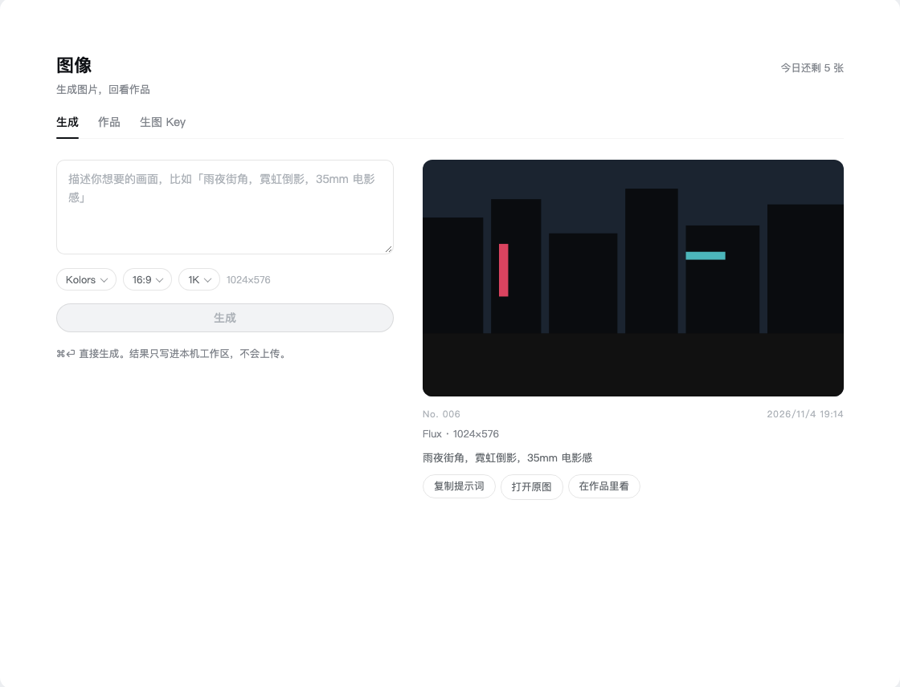
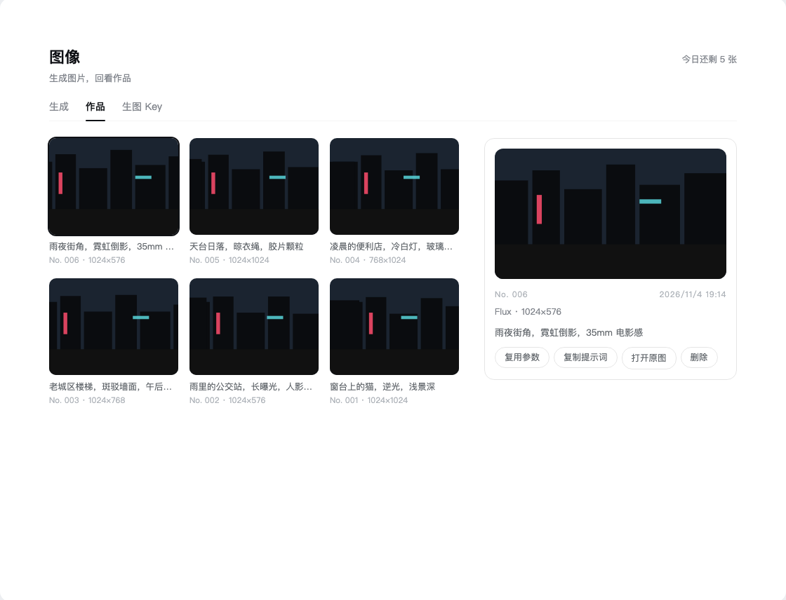

<div align="center">


# dsh-media-skills

**给 DeepSeek Harness 一个图像工作台。**<br>
生成图片、回看作品，也能让智能体帮你检查截图。

[English](../../README.md) · [快速开始](#快速开始) · [图片审查](#图片审查) · [隐私与服务商](#隐私与服务商) · [常见问题](#常见问题)

</div>

## 一个插件，三种用法

| 你想做什么 | 从哪里开始 | 需要什么 |
| --- | --- | --- |
| 生成图片 | 侧边栏 **图像 → 生成** | 桌面端 0.2.1+ 和图片服务商；Pollinations 的 Flux 配置为免 Key |
| 回看或复用作品 | **图像 → 作品** | 页面在本地存储中保留最多 60 条最近记录 |
| 描述或检查图片 | 让智能体使用 `vision-review`，或在聊天中选择支持图片的模型 | 审查技能需要配置视觉服务商；原生图片附件需要当前聊天模型支持图片输入 |

侧边栏面板与 `media-tools` 使用同一份[生图脚本](../../skills/media-tools/scripts/generate.py)，`vision-review` 是独立的[读图审查技能](../../skills/vision-review/SKILL.md)。

## 快速开始

1. 在 DeepSeek Harness 桌面端打开 **插件 → 添加插件**，输入 `dsh-media-skills` 并安装。也可以使用桌面端 profile：

   ```sh
   dsh plugin --profile desktop add dsh-media-skills
   ```

2. 重启 DSH。在桌面端 0.2.1+ 中，打开侧边栏的 **图像**。
3. 输入提示词，选择 **Flux**（Pollinations）并生成。这个入口不需要 Key；服务可用性、尺寸和频率限制以服务商为准。
4. 打开 **作品** 回看结果；想使用其他服务商时，可在 **生图 Key** 中配置。

两个技能随插件注册。`vision-review` 读图需要已配置的视觉服务商；**免 Key 生图不代表读图也免配置**。

> 首次使用时，第三方服务可能限流或不可用。若 Flux 失败，可检查服务状态，或配置其他支持的服务商。

## 图像页面



*界面示意图；图中的图片为占位内容，不是生成结果。实际界面和可用模型可能不同。*

输入提示词，选择模型、画幅和尺寸；结果卡展示图片及其设置。**作品**页可以回看图片、复制提示词、复用参数或删除文件。



*作品页示意图；缩略图为占位内容。*

**仓库中的生成示例**。提示词和服务商信息见 [examples](../../examples/README.md)。

 

## 图片审查

可以让智能体用 `vision-review` 描述本地图片、检查界面截图，或输出结构化观察。脚本支持自行配置的视觉服务商和故障转移；详见 [vision-review/SKILL.md](../../skills/vision-review/SKILL.md)。

聊天里的原生图片附件是 DSH 的独立功能：**当前选择的模型必须支持图片输入**。如果纯文本模型拒绝附件，可切换到视觉模型，或在配置视觉服务商后通过文件路径使用 `vision-review`。安装插件不会让纯文本模型本身获得视觉能力。

## 隐私与服务商

- 插件不内置 API Key。通过面板配置的密钥保存在本机 `~/.dsh/secrets/media-tools.env`；代码会在系统支持时设置文件权限 `600`。
- 提示词和相关请求参数会发给你选择的生图服务商；使用读图审查时，图片会发给配置的视觉服务商。自定义端点由用户选择。
- 图片生成后保存在本地工作区；页面在本地存储中保留最多 60 条最近记录。删除记录时会尝试删除文件；如果文件删除失败，记录仍会移除，文件可能留在磁盘上。服务商各自的数据处理规则仍然适用。
- 免费额度、限制、水印、模型和条款可能变化。发送敏感内容或依赖免费服务前，请查看对应服务商的规则。

详见 [生图技能](../../skills/media-tools/SKILL.md) · [读图配置](../SETUP_VISION.md) · [与 ModLens 共存](../COMPARE_MODLENS.md)。

## 常见问题

**安装后没有图像页面？** 页面需要桌面端 0.2.1+，安装插件后请重启。受支持的旧宿主可单独使用技能；参见[兼容说明](../DESKTOP_0.2.md)。

**生图失败？** 检查选择的服务商、网络、账户余额和频率限制；面板会对常见 HTTP 错误给出提示。

**聊天框拒绝图片？** 确认当前聊天模型支持图片输入；也可以配置视觉服务商后，通过文件路径使用读图技能。

**怎么排查读图技能？** 在仓库目录运行 `python3 skills/vision-review/scripts/vision.py --doctor`。部分检查可能连接已配置的服务商。

## 语言与开发

[English](../../README.md) · **简体中文** · [繁體中文](README_ZH_TW.md) · [日本語](README_JA.md) · [한국어](README_KO.md) · [Español](README_ES.md) · [Deutsch](README_DE.md) · [Português](README_PT.md) · [Русский](README_RU.md)

英文与简体中文介绍当前图像页面；其他翻译保留供参考，可能描述旧版本。

开发检查需要 Node.js 22.19+ 和 Python 3.9+；读图依赖 Pillow。在仓库目录运行 `npm test`。欢迎通过 [Issues](https://github.com/MJorgin/dsh-media-skills/issues)反馈问题。

[MIT 许可证](../../LICENSE)
