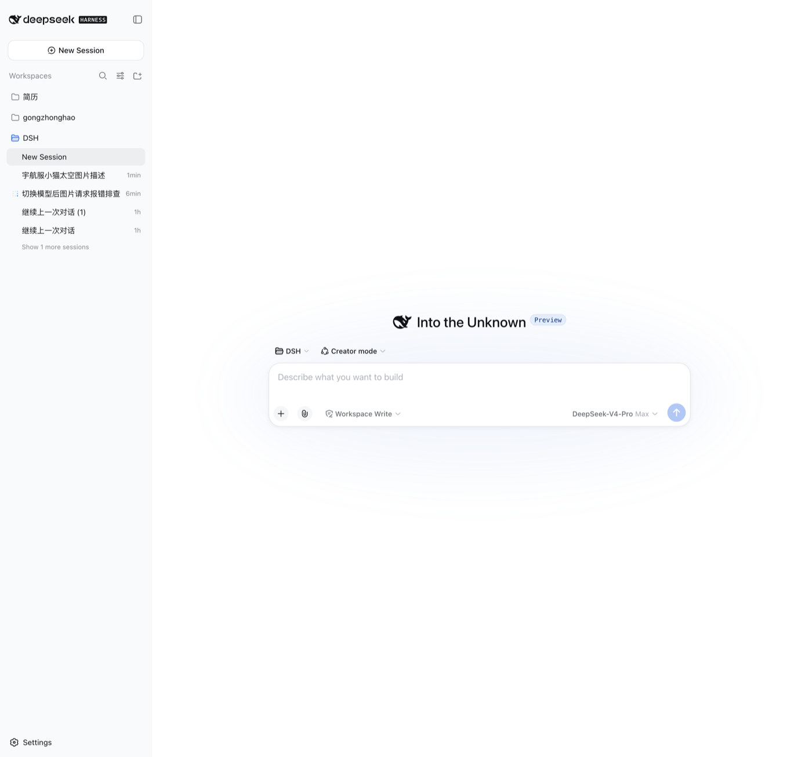
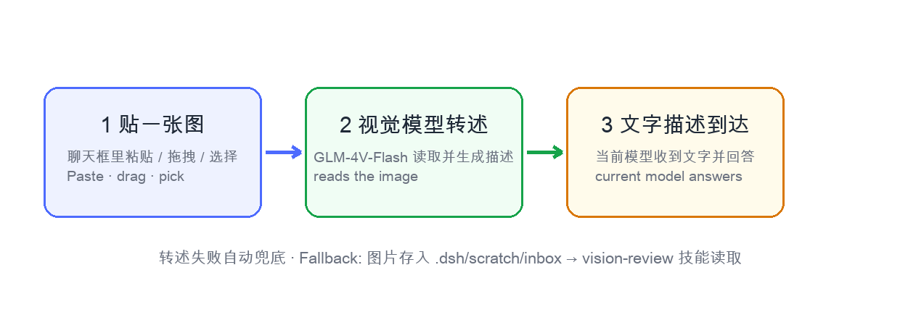
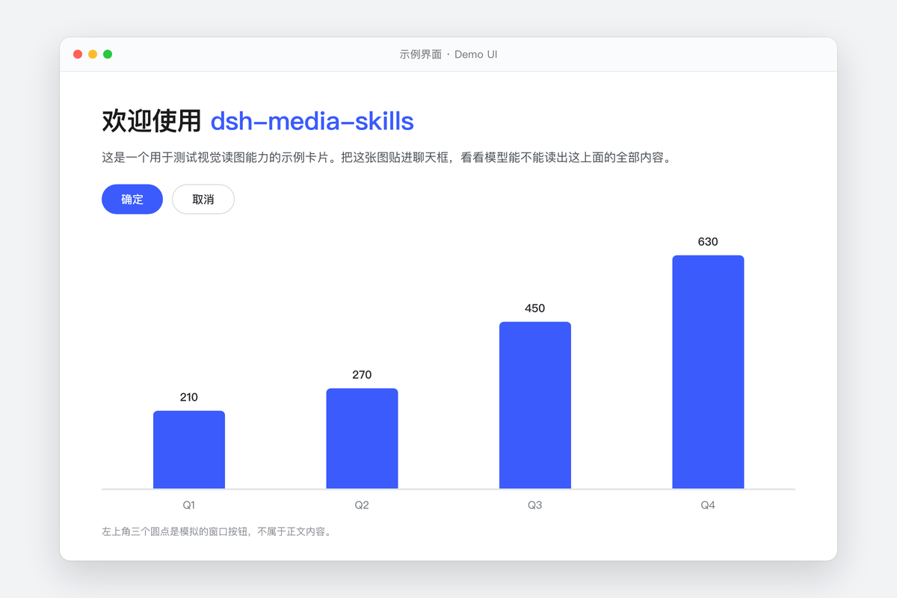

<div align="center">


<br>

# 🎨 dsh-media-skills

### *賦予 DeepSeek Harness 可重用的圖片審查與圖片生成技能——已於 Desktop 0.2.0-rc.2 驗證。*

[](../../LICENSE)
[](https://python.org)
[](https://github.com/topics/dsh-plugin)
[](../SETUP_VISION_EN.md)
[](../FREE_VISION_PROVIDERS_EN.md)
[](README_ZH_TW.md#-金鑰與隱私)
[](README_ZH_TW.md)
[](../DESKTOP_0.2.md)

<br>

DeepSeek Harness 的推理能力十分出色，但圖片輸入取決於目前模型的模態。這個套件提供**兩個運行時技能**與一條**自帶金鑰的視覺容錯移轉鏈**：已在桌面版 **0.2.0-rc.2** 完成運行時驗證，並已對最新 tag **dsh-v0.2.1-rc.2** 原始碼確認相同的 provider 契約。

- 🖼️ **原生圖片附件**——在桌面版 0.2 / v0.1.6+，當**目前模型支援圖片**時可貼上、拖曳或選擇圖片（預設 `deepseek-flash` 支援）。純文字路由會拒絕圖片准入，而不是使用舊的自動轉述管道。
- 👁️ **`vision-review`**——分析圖片與螢幕截圖、找出 UI 視覺錯誤、偵測浮水印、將圖片轉成文字。
- 🎨 **`media-tools`**——用免費、無浮水印的模型生成插圖、頭像、背景與橫幅。
- 🔀 **引擎容錯移轉**——GLM-4V-Flash → **DeepSeek-V4-Flash-Vision-Exp**（與主 agent 同 key）→ SiliconFlow Qwen3-VL → SenseNova → Google Gemini（[AI Studio](https://aistudio.google.com)）→ 任何 OpenAI 相容端點，並輸出 ModLens 風格的結構化證據。

不寫死金鑰、不需要核心修補，也不會在桌面版 0.2 隱藏寫入模型設定；生成檔案只會寫到你明確要求的位置。

[為什麼](#-為什麼) · [快速開始](#-快速開始) · [相容性](#-相容性) · [看看實際效果](#-看看實際效果) · [使用方法](#-使用方法) · [金鑰與隱私](#-金鑰與隱私) · [常見問題](#-常見問題) · [範例](#-範例)

[**English**](../../README.md) · [**简体中文**](README_ZH.md) · [**繁體中文**](README_ZH_TW.md) · [**日本語**](README_JA.md) · [**한국어**](README_KO.md) · [**Español**](README_ES.md) · [**Deutsch**](README_DE.md) · [**Português**](README_PT.md) · [**Русский**](README_RU.md)

</div>

---

## 🤔 為什麼

多數 DSH 視覺外掛只能**讀取**圖片——而且很多會把你導向共用的第三方端點。`dsh-media-skills` 採取不同的立場：

| | 本套件 | 一般僅視覺外掛 |
|---|---|---|
| 讀取圖片 | ✅ 桌面版 0.2 使用目前選中的圖片模型；`vision-review` 另提供 GLM-4V-Flash 與可選 provider 容錯移轉，適合腳本化 QA | ✅ |
| 免費**生成**圖片 | ✅ SiliconFlow Kolors | ❌ 通常沒有 |
| 模型路由管理 | ✅ 桌面版 0.2 / v0.1.6+ 絕不寫入設定——請在 **設定 → 模型** 選擇路由；自動加入路由只存在於歷史版本 | 有時 |
| 金鑰提交至儲存庫 | ❌ 絕不——金鑰僅存本機 | ⚠️ 通常需要 |
| 多語言說明文件 | ✅ 9 種語言 | ❌ 通常只有英文 |
| 隱私 | ✅ 由你選擇供應商；圖片只會傳給你的供應商 | 共用免費端點可能看到你的圖片 |

**為什麼要自備免費金鑰，而不是使用內建的匿名端點？** 隱私與可靠性。你的圖片只會傳給你選擇的供應商，在你的帳戶與速率限制之下運作——中間沒有任何共用的第三方服務。

## 🔌 相容性

| DSH 版本／建置 | 狀態 |
|---|---|
| 桌面版 **0.2.0-rc.2** | **運行時驗證。** 標準運行時外掛；兩個技能透過 `ctx.skills.registerProvider()` 註冊。原生附件只在模型宣告 `inputModalities: ["text", "image"]` 時准入；預設 `deepseek-flash` 路由支援。不需要核心修補，也不寫入設定。 |
| Tag **dsh-v0.2.1-rc.2** | **原始碼已比對。** `@deepseek-ai/dsh-skill@0.2.1-rc.2` 保留 provider factory、`list()`/`get()`、candidate 欄位與圖片准入行為。本機沒有可完整啟動測試的 rc.2 打包桌面版。 |
| **v0.1.6** | 同樣使用受支援的 provider 生命週期；可選 GLM/SiliconFlow/SenseNova/Gemini 路由請在 **設定 → 模型** 設定。 |
| v0.1.1 與更早預覽版 | 僅供歷史行為參考。請不要把舊核心修補用於已簽章的桌面版 0.2。 |

完整檢查清單見 [Desktop 0.2 相容性說明](../DESKTOP_0.2.md)。

## ✨ 你會獲得什麼

| 功能 | 作用 | 模型 | 費用 |
|---|---|---|---|
| 🖼️ 原生圖片附件 | 選中圖片模型後，可貼上、拖曳或使用附件按鈕。DSH 會檢查目前模型的 `inputModalities`；純文字路由會回傳 `MODEL_DOES_NOT_SUPPORT_IMAGES`，不會啟動舊的自動轉述管道。 | 預設 `deepseek-flash`，或你設定的視覺路由 | 依所選 provider 而定 |
| 👁️ `vision-review` | 分析／辨識／描述本地圖片與螢幕截圖；找出 UI 視覺錯誤、浮水印／Logo，執行 OCR，或輸出結構化 JSON 證據。可選容錯移轉鏈：GLM-4V-Flash → DeepSeek Vision → SiliconFlow Qwen3-VL → SenseNova → Google Gemini → 自訂 OpenAI 相容端點。 | GLM-4V-Flash＋可選 DeepSeek/Qwen/SenseNova/Gemini | GLM/SiliconFlow 免費額度；其他 provider 可選 |
| 👁️ `vision-review` | 分析／辨識／描述圖片與螢幕截圖；找出 UI 視覺錯誤（重疊、溢出、未對齊）；偵測浮水印／標誌；將圖片轉成文字。選用的 `--structured` 模式會回傳 ModLens 風格的證據 JSON（摘要、完整 OCR、閱讀順序版面、實體／關係、不確定性）。引擎容錯移轉鏈：GLM-4V-Flash → DeepSeek-V4-Flash-Vision-Exp（與主 agent 同 key，可選付費）→ SiliconFlow Qwen3-VL／SenseNova／Google Gemini（有金鑰即自動加入）→ 任何 OpenAI 相容端點 | GLM-4V-Flash＋DeepSeek-Vision-Exp＋Qwen3-VL＋SenseNova＋Gemini | 免費（DeepSeek 可選付費） |
| 🎨 `media-tools` | 生成圖片、插圖、頭像、背景、橫幅 | SenseNova U1 Fast → SiliconFlow Kolors | 免費、無浮水印 |

## ⚡ 快速開始

```sh
dsh plugin --profile <name> add github:MJorgin/dsh-media-skills
```

1. **金鑰**：
   - **桌面版 0.2 / v0.1.6+**：安裝無需金鑰——兩個技能隨外掛運行時註冊，預設 `deepseek-flash` 路由支援原生圖片對話。技能腳本金鑰（`GLM_API_KEY`、`SILICONFLOW_API_KEY`、可選 `GEMINI_API_KEY`）寫入 `~/.dsh/secrets/media-tools.env`；額外模型路由在 **設定 → 模型** 自行設定。
   - **舊版 ≤ v0.1.1 預覽版**：當時的貼圖讀取與視覺路由可使用主 agent 現有的 `DEEPSEEK_API_KEY`（DeepSeek-V4-Flash-Vision-Exp）；這套自動轉述行為不適用於桌面版 0.2。
   - **rc.7 / rc.8**（或想加免費引擎）：Zhipu——[open.bigmodel.cn](https://open.bigmodel.cn) → **API Keys**（`glm-4v-flash` 免費）；SiliconFlow——[siliconflow.cn](https://siliconflow.cn) → **API Keys**（Kolors 免費）；*（選用）* Google Gemini——[aistudio.google.com](https://aistudio.google.com) → **Get API key**；會自動加入視覺容錯移轉鏈
2. **加入金鑰**：在網頁介面（**設定 → 模型**）中輸入，或使用憑證檔案：

   ```sh
   # ~/.dsh/.credentials.yaml (chmod 600)
   GLM_API_KEY: <你的金鑰>
   ```

3. **重新啟動** `dsh web`，然後強制重新整理（`Cmd+Shift+R`）。

驗證：技能清單出現 **`vision-review`** 與 **`media-tools`**。在桌面版 0.2 發送原生附件前，請先選取 **`deepseek-flash`** 等支援圖片的路由；純文字路由會回傳 `MODEL_DOES_NOT_SUPPORT_IMAGES`，不會自動描述圖片。

完整步驟與疑難排解：[../SETUP_VISION_EN.md](../SETUP_VISION_EN.md)。

## 📸 看看實際效果

*把附件傳給支援圖片的 DSH 路由，或把檔案路徑交給 `vision-review` 做腳本化 QA；同一個套件也能按需生成新圖片。*



*舊版預覽版的圖片轉述流程示意：*



## 🚀 使用方法

讀取圖片的三種方式：

| 方式 | 做法 | 時機 |
|---|---|---|
| **A. 原生附件（建議）** | 先選支援圖片的路由（預設 `deepseek-flash`），再點附件按鈕／拖曳／貼上圖片後送出 | 日常多模態圖片問題 |
| **B. 圖片模型工作階段** | 開新對話，選擇 `deepseek-flash` 或已設定的 GLM/Qwen/SenseNova 視覺路由，再貼圖交談 | 多輪原生圖片對話 |
| **C. 檔案＋技能** | 把圖片放進工作區，說「用 vision-review 讀取這張圖片」 | 批次審查、腳本化工作流程 |

原生附件會直接傳送給目前選中的圖片模型；使用 `vision-review` 時，可在提示詞中指定語言或輸出格式（也可用 `--structured`）。

也可以直接說：

- 「看看這張圖片／檢查這張截圖有沒有視覺錯誤」 → `vision-review`
- 「生成一張……的圖片」 → `media-tools`

## 🔑 金鑰與隱私

金鑰**絕不儲存在這個儲存庫中**。獨立的 `vision-review` 腳本依序讀取：環境變數 → `~/.dsh/secrets/media-tools.env` → `~/.codex/secrets/media-tools.env`（舊版備援）。舊版自動設定 GLM 路由只適用於 ≤ v0.1.1；桌面版 0.2 / v0.1.6+ 的路由由你在 **設定 → 模型** 管理。

技能引擎的金鑰取得方式（免費額度依 provider 條款）：Zhipu——[open.bigmodel.cn](https://open.bigmodel.cn) → API Keys（glm-4v-flash）。SiliconFlow——[siliconflow.cn](https://siliconflow.cn) → API Keys（Kolors）。Google（選用，會自動加入視覺容錯移轉鏈）——[aistudio.google.com](https://aistudio.google.com) → Get API key。

```sh
# ~/.dsh/secrets/media-tools.env（chmod 600，每行一個 KEY=value）
GLM_API_KEY=...
SILICONFLOW_API_KEY=...
GEMINI_API_KEY=...   # 選用
```

你的圖片只會傳給你設定的供應商——絕不會傳給這個儲存庫，也不會傳給共用的匿名端點。

> Gemini 的隱私提醒：Google 免費層級金鑰附有資料使用條款——請求內容可能被用於改善 Google 產品。對於敏感圖片（身分證件、內部文件、客戶資料），建議優先使用直接連線的引擎（Zhipu／SiliconFlow）。

## ❓ 常見問題

**桌面版 0.2 還需要修改核心嗎？**
不需要。桌面版 **0.2.0-rc.2** 透過標準運行時外掛／provider 生命週期載入這個 bundle，圖片准入由目前模型的 `inputModalities` 決定。請不要修改已簽章的 `app.asar`；舊預覽版修補僅供歷史歸檔。若目前是純文字路由，DSH 會回傳 `MODEL_DOES_NOT_SUPPORT_IMAGES`，請切換到圖片模型，或用檔案路徑呼叫 `vision-review`。

**為什麼不乾脆使用完全不需要金鑰的內建免費端點？**
我們傾向讓你自己掌控路由：你的圖片會傳給你選擇的供應商，在你的速率限制之下運作，中間沒有共用的仲介。金鑰免費，大約兩分鐘就能建立。

**`media-tools` 真的免費嗎？**
是的——SiliconFlow Kolors 免費且無浮水印。如果某個模型暫時停用，技能會列出可用模型，你可以自行切換。

## 🎁 範例

可立即試用的範例素材——6 張 AI 生成圖片及其提示詞，加上一張專為檢查讀取準確度設計的視覺測試卡（標題、按鈕、長條圖數值）：

  

→ [../../examples/README.md](../../examples/README.md)

## 🗺️ 目錄結構

```
dsh-media-skills/
├── package.json           # dsh.bundle 清單
├── cordis.patch.yml       # 外掛層
├── index.js               # 透過 v0.1.6+ / Desktop 0.2 provider 生命週期註冊兩個技能
├── skills/
│   ├── vision-review/     # 圖片讀取
│   └── media-tools/       # 圖片生成
├── examples/              # 範例圖片＋視覺測試卡
├── docs/
│   ├── screenshots/       # 示範樣板與運作原理示意圖
│   ├── SETUP_VISION_EN.md # 詳細設定指南（英文）
│   ├── SETUP_VISION.md    # 詳細設定指南（中文）
│   ├── HARNESS_PATCH_EN.md# 核心修補說明（英文）
│   ├── HARNESS_PATCH.md   # 主程式修補說明（中文）
│   ├── COMPARE_MODLENS.md # 與 ModLens 的比較／共存（中文）
│   └── lang/              # 9 種語言的 README
├── scripts/make-banner.py # 重新生成 docs/social-preview.png
└── docs/social-preview.png
```

## 🧩 想與 ModLens 並用？

這個套件可與 [ModLens](https://github.com/liustack/modlens) 同時安裝，但桌面版 0.2 已沒有舊的 api-proxy 自動轉述備援。請明確選擇一種貼上行為：保留 ModLens 的「貼上轉檔案路徑」工具流，或設定 `pasteToPath: false`，讓 DSH 對支援圖片的模型使用原生附件。歷史比較與設定請見 [../COMPARE_MODLENS.md](../COMPARE_MODLENS.md)（中文）。

## 🤝 加入 DSH 外掛生態系

DeepSeek Harness 開發者預覽版對 Harness 開發者而言仍處於測試階段；核心外掛與基礎 API 將持續迭代。我們期待與全球開發者一起，在開放原始碼、開放、可重用且可組合的基礎設施之上，探索智慧的極限。

- [dsh-plugin topic](https://github.com/topics/dsh-plugin)
- [Quickstart](https://deepseek-harness.github.io/deepseek-harness/guide/quickstart)
- [DeepSeek Harness repo](https://github.com/deepseek-ai/deepseek-harness)

> 這個儲存庫已標記為 [`dsh-plugin`](https://github.com/topics/dsh-plugin) 並收錄於 [awesome-dsh-plugin](https://github.com/awesome-dsh-plugin/awesome-dsh-plugin) 精選清單。歡迎提交 PR、回報問題與翻譯貢獻。

## 📄 授權條款

[MIT](../../LICENSE)
